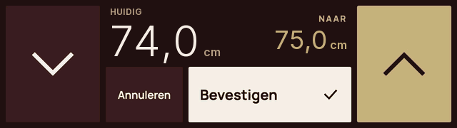
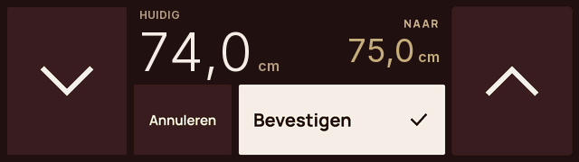

# Persistent local panel settings

Part of issue #12. Source version 0.8.0 stores rotation, panel brightness and dim timeout. This is not installation or hardware acceptance and does not implement managed configuration writes yet.

## Schema and storage

Schema 1 contains `brightness` (integer 10–100), `rotated` (boolean), `dim_minutes` (0, 1, 2 or 5) and a monotonic 32-bit `revision`. Defaults are 100%, not rotated and 1 minute; absent storage has revision 0. Wi-Fi credentials, desk presets, target height and actual device status are not stored in this configuration. Desk presets remain temporary demo settings only; personal/controller presets are not managed.

The dedicated NVS namespace `panel-ui` has two fixed blobs, `ui0`/`ui1`. A 20-byte record contains magic `NP`, schema version, little-endian revision, values, zero reserved bytes and an FNV-1a integrity check. This checksum detects corruption; it is not a cryptographic signature. Each write replaces the other slot using an atomic NVS blob write and is read back for confirmation. Only then are saved values and revision applied in RAM. The previous valid configuration remains available. The Wi-Fi namespace is not erased or modified.

At boot, the valid schema-1 record with the highest revision wins. Corrupt, interrupted or invalid records are skipped; without a valid record, defaults are used. There is no earlier stored UI schema to migrate: before 0.8.0 these settings existed only in RAM. A future schema version with recognizable magic blocks writes from this older firmware; it uses the previous readable configuration or defaults without silently overwriting the newer configuration. A later schema change must add an explicit migration with tests. Changes are rejected on revision overflow.

## Application and ownership

Only a physical touch gesture can initiate storage. The UI previews a slider while dragging; release writes at most one record. Unchanged values cause no writes. Rotation applies to both the complete framebuffer and touch coordinates. Dim timeout 0 disables the timer. The first touch after idle only wakes the screen; it changes no setting and writes nothing. Normal navigation and local demo reset preserve panel settings. Explicit bench scenes remain predictable temporary examples and do not write NVS.

On a storage error, the UI immediately restores the previous saved configuration. Status reports `write_failed: true`; no successful new revision is reported. A later successful changed write clears the error. If a complete write succeeds but verification cannot be read, the current runtime keeps the previous configuration; after restart the new fully valid record may be selected.

The local user is currently the only writer. There is no managed-configuration capability or `config.set`: these requests remain `unsupported_message` and receive no write/movement rights. This prevents a host from overwriting a local change. A future managed adapter requires explicit authorization and conflict checking against the expected saved revision; this synchronization remains work for #12. Credentials do not appear in UI configuration status.

## Status

The handshake additionally advertises `panel.config.status.v1`. A `state.get` optionally includes `state.panel_config`:

```json
{"schema":1,"revision":3,"brightness":35,"rotated":true,"dim_minutes":5,"writable":true,"write_failed":false}
```

This is the saved configuration, not a change command. An active drag has no saved revision yet and may temporarily show a different preview value. An older host may ignore this optional status field. Existing USB/Wi-Fi bench status contains the same `panel_config` object. The revision survives reboot and is separate from per-session status and device-state revisions.

## Verification and remaining acceptance

`tests/test_panel_settings.py` compiles the actual C++ journal and UI. It restarts the journal, interrupts writes at every byte boundary, corrupts every record byte, checks defaults/validation/future schemas/read-back failure and tests rotated touch, dimming, wake-only and preservation through navigation/reset. The existing full host/C++ suite and firmware build still apply.

Physical work still required: multiple local changes with restarts and power interruptions; rotated touch; dim/wake; unavailable/full NVS; appearance at several brightness levels. Brightness currently scales rendered pixels; physical backlight control is unproven. No backlight/power claim is made. Issue #12 remains open for hardware acceptance and authorized managed-configuration synchronization.

## Arrow feedback in the same firmware

The Confirm base image contained a colored arrow. That color remained after a single tap even though the touch had ended. The renderer now draws neutral arrows by default and applies the pressed color only while a valid arrow gesture is active. Release, leaving the button or interruption restores the normal button color; the selected height is retained for confirmation. Selecting a preset does not leave an arrow looking pressed.

`tests/test_arrow_feedback.py` first reproduced the color difference after release and now covers up/down, tap, hold/release, dragging outside the button, busy state, preset selection and rotation. The comparison uses actual firmware pixels. This is software evidence, not a new physical installation.

Native renders from the same firmware class with synthetic demo height, not hardware photographs:

| During touch | After release |
| --- | --- |
|  |  |
